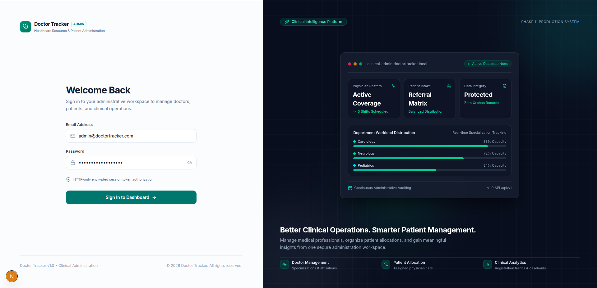
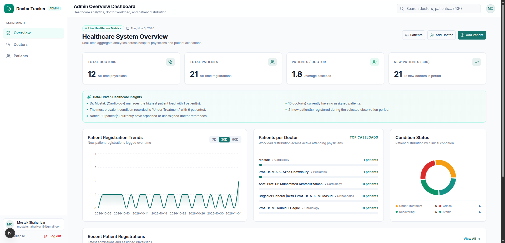
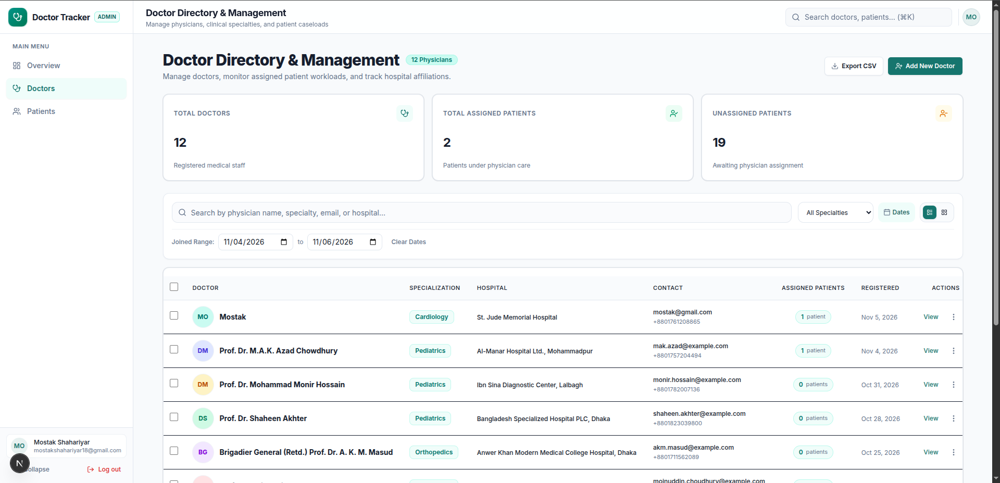
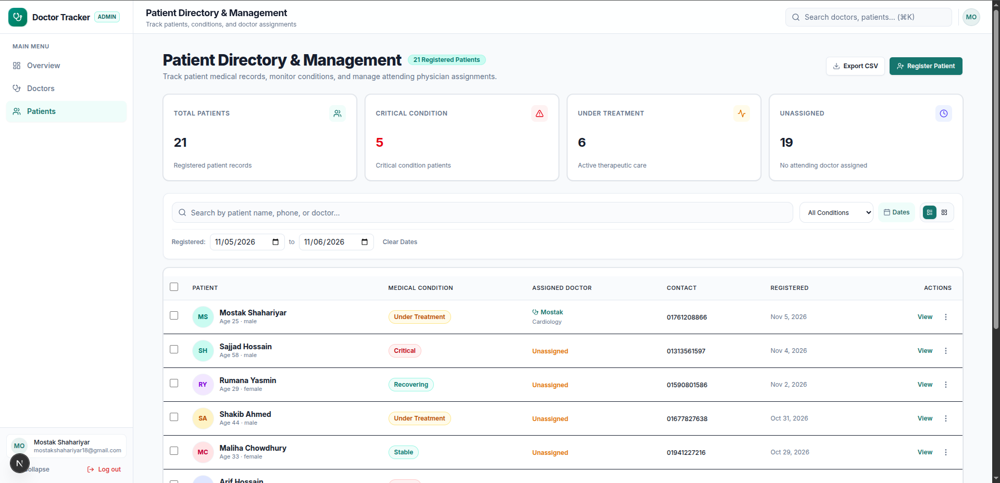
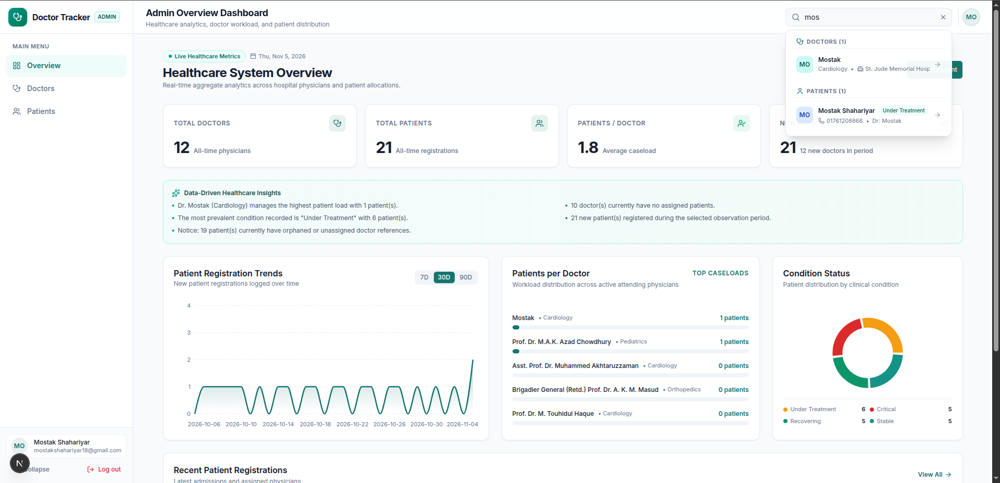
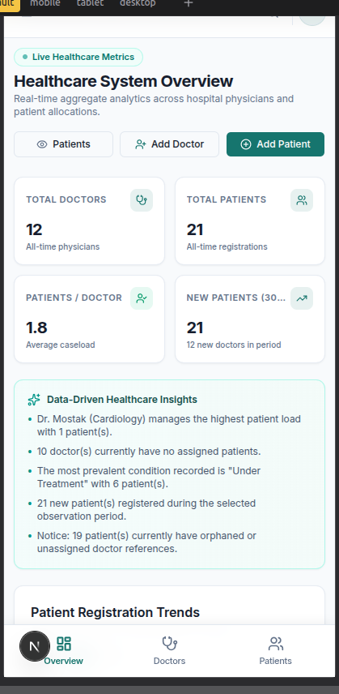
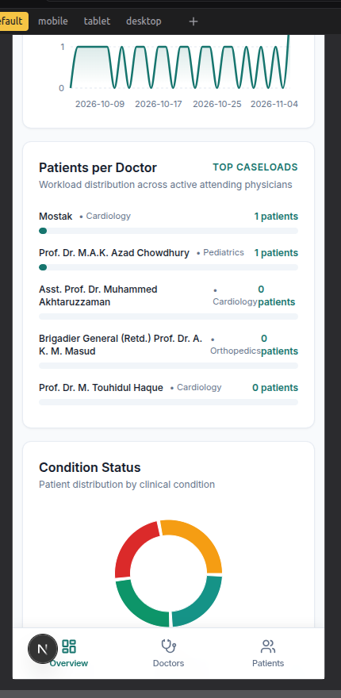
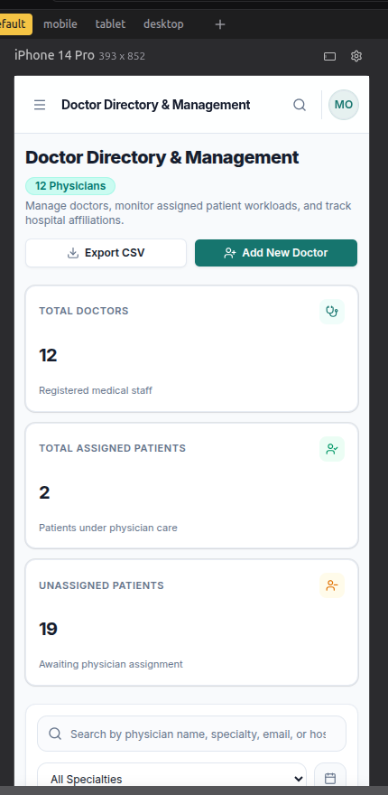
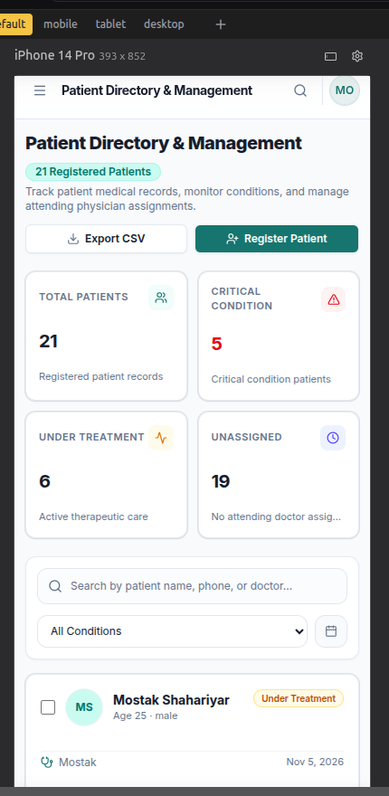

# Doctor Tracker — Clinical Resource & Patient Management System

A full-stack healthcare administrative platform designed to track medical personnel, monitor patient condition distributions, manage physician assignments, and provide real-time clinical workload analytics.

Built with **Next.js 16 (App Router, React 19, Turbopack)**, **Express 5 (TypeScript)**, and **MongoDB (Mongoose 9)**.

[](https://github.com/shahariyar23/Doctor-Tracker)
[](./server/tests)
[](./web/e2e)
[](#license)

---

## Table of Contents

1. [Project Overview](#1-project-overview)
2. [Key Features](#2-key-features)
3. [Technology Stack](#3-technology-stack)
4. [Project Architecture](#4-project-architecture)
5. [Application Data Flow](#5-application-data-flow)
6. [Installation & Local Setup](#6-installation--local-setup)
7. [Environment Variables](#7-environment-variables)
8. [Important Technical Decisions](#8-important-technical-decisions)
   - [8.1 Authentication Architecture](#81-authentication-architecture)
   - [8.2 Data Fetching & State Management](#82-data-fetching--state-management)
9. [API Documentation](#9-api-documentation)
10. [Screenshots](#10-screenshots)
11. [Project Links](#11-project-links)

---

## 1. Project Overview

### Problem Statement
Healthcare administration frequently suffers from fragmented tracking systems, manual spreadsheet bottlenecks, and inaccurate physician-to-patient allocation records. Misallocated patient loads lead to physician burnout, triage delays, and unassigned patients slipping through the cracks.

### Purpose & Objectives
**Doctor Tracker** addresses this challenge by providing a central management portal for hospital administrators. The platform establishes strict data integrity between physicians and admitted patients, offering:
- Clear visibility into unassigned patients requiring attending physician triage.
- Verified physician assignment and reassignment workflows without creating duplicate records.
- Live, computed clinical analytics derived from database records (no mocked or synthetic data).
- Robust security safeguarding administrative operations with HTTP-only cookie authentication and rigorous input validation.

---

## 2. Key Features

- **Administrative Authentication & Protected Routes**:
  - Secure login with email and password verified against salted bcrypt hashes.
  - HTTP-only signed session cookies preventing client-side XSS token theft.
  - Route guards on both frontend Next.js App Router and Express API middleware.
- **Doctor Management**:
  - Complete physician registry (Name, Specialization, Hospital, Phone, Email, Registration Date).
  - Dynamic active patient caseload calculation via MongoDB `$lookup` aggregation pipelines.
  - Multi-field search across physician name, specialization, hospital, email, and phone.
  - Doctor profile modal & dedicated route (`/doctors/[doctorId]`).
  - Doctor deletion safeguard: Deletion is blocked with an HTTP 409 Conflict if active patients remain assigned to the physician.
- **Patient Management**:
  - Patient tracking with verified fields: Name, Medical Condition (*Critical*, *Under Treatment*, *Stable*, *Recovering*), Age, Gender, Phone, Registration Date.
  - Live condition filtering, debounced search, and date-range filters.
  - Bulk actions for batch reassignment and batch deletion.
  - Patient detail modal and patient registration workflow.
- **Physician Assignment & Reassignment Engine**:
  - Assign unassigned patients to available physicians with debounced search suggestions.
  - Safely reassign patients between physicians with confirmation prompts.
  - Remove patients from a physician's active caseload without deleting the patient record.
  - Zero duplicate patient record creation.
- **Global Search API & Universal Header Combobox**:
  - Dedicated `/api/v1/search?q=<term>` endpoint executing parallel regex-escaped searches across Doctors and Patients.
  - Global `⌘K` / `Ctrl+K` keyboard shortcut accessible from any page.
  - Grouped results with arrow-key keyboard navigation and instant route transition.
- **Clinical Analytics Dashboard**:
  - Aggregated metrics: Total Doctors, Total Patients, Unassigned Patients, Critical Care caseload.
  - Specialization workload distribution charts and condition breakdown graphs powered by Recharts.
- **Responsive Healthcare Interface**:
  - Fully responsive desktop and mobile viewports.
  - Automatic table-to-card stack transformation on mobile screens.

---

## 3. Technology Stack

### Frontend (`web/`)
- **Framework**: Next.js 16.4.4 (App Router, Turbopack, Partial Prerendering)
- **UI Library**: React 19.3.0
- **Language**: TypeScript 5 (`typescript@^5`, resolved `5.9.3`)
- **Styling**: Tailwind CSS v4, tw-animate-css
- **Components & Icons**: shadcn/ui, Lucide React, Base UI (`@base-ui/react`)
- **Server State & Data Fetching**: TanStack Query v5 (`@tanstack/react-query`)
- **Client State**: Redux Toolkit (`@reduxjs/toolkit`, `react-redux`)
- **Forms & Validation**: React Hook Form, Zod v4, `@hookform/resolvers`
- **Data Visualization**: Recharts v3
- **HTTP Client**: Axios with credentials (`withCredentials: true`)
- **Testing**: Playwright 1.64.1 (E2E browser automation)

### Backend (`server/`)
- **Runtime**: Node.js (ES Modules, `type: "module"`)
- **Framework**: Express 5.3.0
- **Language**: TypeScript 7 (`typescript@^7.0.2` dev dependency)
- **Database & ODM**: MongoDB with Mongoose 9.11.4
- **Validation**: Zod v4 (strictly typed request validation middleware)
- **Authentication & Security**: JSON Web Tokens (`jsonwebtoken`), `bcrypt`, `cookie-parser`, `helmet`, `cors`, `express-rate-limit`
- **Testing**: Vitest 5.1.0, Supertest 7.3.1
- **Process & Scripts**: tsx (TypeScript execution for seeders and test runners)

---

## 4. Project Architecture

```
Doctor_Tracker/
├── web/                          # Next.js 16 Frontend Application
│   ├── e2e/                      # Playwright End-to-End Test Suite
│   ├── public/                   # Static assets & icons
│   ├── src/
│   │   ├── app/                  # Next.js App Router Pages
│   │   │   ├── (auth)/login/     # Admin Authentication page
│   │   │   ├── (dashboard)/      # Protected Application Shell
│   │   │   │   ├── dashboard/    # Analytics Overview
│   │   │   │   ├── doctors/      # Doctor Directory & Doctor Profile ([doctorId])
│   │   │   │   └── patients/     # Patient Directory & Registration
│   │   ├── components/           # Global UI components, AppShell, Header, Sidebar
│   │   │   └── layout/           # GlobalSearch, Header, AppShell, MobileNav
│   │   ├── features/             # Domain-driven feature modules
│   │   │   ├── auth/             # Login forms, auth service, auth hooks, schemas
│   │   │   ├── dashboard/        # Analytics widgets, distribution charts
│   │   │   ├── doctors/          # Doctor tables, assignment modals, hooks
│   │   │   └── patients/         # Patient tables, detail modals, hooks
│   │   ├── hooks/                # Reusable hooks (useDebounce, useGlobalSearch)
│   │   ├── lib/                  # Axios instance (apiClient) & utility functions
│   │   ├── providers/            # Redux Provider, QueryClientProvider, AuthInitializer
│   │   ├── store/                # Redux Toolkit store and slices (auth, ui)
│   │   └── types/                # Shared TypeScript contracts & API models
│   ├── playwright.config.ts      # Playwright test configuration
│   └── package.json
│
├── server/                       # Express 5 + TypeScript Backend API
│   ├── api/                      # Vercel Serverless Function entrypoint (index.ts)
│   ├── scripts/                  # Seeders (seed-admin.ts, seed-e2e.ts)
│   ├── src/
│   │   ├── config/               # Environment & database connection configs
│   │   ├── controllers/          # Request handlers (auth, doctor, patient, search, dashboard)
│   │   ├── middlewares/          # Auth guard, Zod validator, error handler, not-found
│   │   ├── models/               # Mongoose Schemas (Admin, Doctor, Patient)
│   │   ├── routes/               # Express Routers (/auth, /doctors, /patients, /search, etc.)
│   │   ├── utils/                # ApiError, ApiResponse, asyncHandler helpers
│   │   ├── validators/           # Zod schemas (common, doctor, patient, search)
│   │   ├── app.ts                # Express app setup and middleware pipeline
│   │   └── server.ts             # Server entry point and HTTP listener
│   ├── tests/                    # Vitest + Supertest integration test suite
│   ├── vercel.json               # Vercel serverless routing rewrite configuration
│   └── package.json
│
├── docs/                         # Technical documentation & test reports
│   ├── QA_TEST_REPORT.md         # Full QA Test Report (Backend & Frontend)
│   └── VERCEL_DEPLOYMENT_GUIDE.md# Cloud deployment instructions
└── README.md
```

---

## 5. Application Data Flow

```
[ Admin User ]
       │
       ▼
[ Next.js 16 App Router (React 19) ]
       │  (State: Redux Toolkit for UI/Session | TanStack Query for Server Cache)
       ▼
[ Axios HTTP Client (`withCredentials: true`) ]
       │  (HTTP / JSON REST Request with `token` Cookie)
       ▼
[ Express 5 REST API Router (/api/v1) ]
       │
       ├──► [ Rate Limiting & Helmet Security Headers ]
       ├──► [ authenticate Middleware (JWT verification via HTTP-only cookie) ]
       ├──► [ validate Middleware (Zod schema verification for body/query/params) ]
       │
       ▼
[ Controller & Query Layer ]
       │  (lean queries, projection, regex safety escaping, aggregation)
       ▼
[ Mongoose 9 ODM ] ──► [ MongoDB Database Engine ]
       ▲
       │  (Typed document / aggregation cursor return)
       ▼
[ ApiResponse Serializer (Standard JSON Envelope) ]
       │
       ▼
[ TanStack Query Cache (Automatic Deduplication & Cache Invalidation) ]
       │
       ▼
[ Next.js UI View (Reactive Render / Recharts / Tables / Modals) ]
```

---

## 6. Installation & Local Setup

### Prerequisites
- **Node.js**: `v20.x` or higher
- **Package Manager**: `pnpm` (v9 or v10 recommended)
- **Database**: Local MongoDB instance (`mongodb://localhost:27017`) or MongoDB Atlas connection string.

### 1. Clone the Repository
```bash
git clone https://github.com/shahariyar23/Doctor-Tracker.git
cd Doctor-Tracker
```

### 2. Configure Backend (`server/`)
In your first terminal:
```bash
cd server
pnpm install

# Copy environment template
cp .env.example .env
```
*Review `.env` and configure your database URI and secrets.*

### 3. Seed Admin User & Run Backend
```bash
# Seed initial administrator account into your database
pnpm seed:admin

# Start Express server in development mode (runs on port 5000)
pnpm dev
```
*The backend API will be available at `http://localhost:5000/api/v1`.*

### 4. Configure Frontend (`web/`)
In a second terminal:
```bash
cd web
pnpm install

# Copy environment template
cp .env.example .env.local
```

### 5. Start Frontend Development Server
```bash
pnpm dev
```
*The frontend application will be live at `http://localhost:3000`.*

### 6. Running Automated Tests

#### Backend Test Suite (Vitest + Supertest)
```bash
cd server
pnpm test
```
*Executes all 68 tests across authentication, doctor CRUD, patient CRUD, doctor assignment, global search, and dashboard analytics against an isolated test database.*

#### Frontend E2E Test Suite (Playwright)
```bash
cd web
# Run Desktop Chrome E2E suite
pnpm exec playwright test --project="Google Chrome Desktop"

# Run Mobile Pixel 5 E2E suite
pnpm exec playwright test --project="Mobile Chrome (Pixel 5)"
```

#### Production Builds
```bash
# Verify backend TypeScript compilation
cd server && pnpm build

# Verify frontend Next.js production build
cd web && pnpm build
```

---

## 7. Environment Variables

### Backend (`server/.env`)

| Variable | Description | Required | Example / Default |
| :--- | :--- | :---: | :--- |
| `NODE_ENV` | Application runtime environment (`development` / `production` / `test`) | Yes | `development` |
| `PORT` | Local port number Express listens on | Yes | `5000` |
| `CLIENT_URL` | Allowed origin for CORS credential exchanges | Yes | `http://localhost:3000` |
| `MONGODB_URI` | MongoDB connection URI string | Yes | `mongodb://localhost:27017/doctor_tracker` |
| `JWT_SECRET` | Secret key for signing and verifying JWT tokens (min 32 chars) | Yes | `your_32_character_minimum_random_secret_here` |
| `JWT_EXPIRES_IN`| Token lifespan string | Yes | `1h` |
| `ADMIN_NAME` | Default administrator name for seeder | Optional | `System Administrator` |
| `ADMIN_EMAIL` | Default administrator email for seeder | Optional | `admin@doctortracker.com` |
| `ADMIN_PASSWORD`| Default administrator password for seeder | Optional | `YourStrongAdminPassword#123` |

### Frontend (`web/.env.local`)

| Variable | Description | Required | Example / Default |
| :--- | :--- | :---: | :--- |
| `NEXT_PUBLIC_API_URL` | Full URL pointing to the Express API with prefix | Yes | `http://localhost:5000/api/v1` |

---

## 8. Important Technical Decisions

### 8.1 Authentication Architecture

#### Selection of JWT with HTTP-Only Cookies
Instead of storing tokens in browser `localStorage` or `sessionStorage` (which are vulnerable to Cross-Site Scripting [XSS] attacks), Doctor Tracker issues JSON Web Tokens inside **HTTP-only, SameSite cookies** named `token`.
- **Security**: The cookie cannot be accessed or manipulated by client-side JavaScript (`document.cookie`), preventing credential exfiltration.
- **CSRF & CORS Defense**: Cookies are configured with `SameSite=Lax` (or `None` with `Secure` in cross-origin production environments), and CORS origins are strictly locked to `CLIENT_URL` with `credentials: true`.
- **Session Rehydration**: When a user opens the application, an `AuthInitializer` component calls `GET /api/v1/auth/me`. The browser automatically transmits the session cookie. If valid, the Redux store hydrates the user's profile without flashing unauthenticated screens.
- **Graceful Logout**: Calling `POST /api/v1/auth/logout` instructs the browser via `Set-Cookie` to immediately expire the cookie (`maxAge: 0`), terminating the session both client-side and server-side.

### 8.2 Data Fetching & State Management

#### Clear Separation Between Server State and Client State
A frequent pitfall in dashboard applications is storing server-originated data (doctors, patients, analytics) in global client state stores like Redux. Doctor Tracker enforces a strict architectural boundary:
1. **Server State (TanStack Query v5)**:
   - Manages asynchronous remote data: fetching, caching, deduplication, background revalidation, and pagination states.
   - Mutations automatically invalidate related query keys. For example, assigning a patient invalidates `['patients']`, `['doctors']`, and `['dashboard']`, ensuring instant visual consistency without full page reloads.
   - Built-in abort signals cancel obsolete inflight HTTP requests during debounced typing in search fields.
2. **Client State (Redux Toolkit)**:
   - Restricted strictly to synchronous, ephemeral client UI state: sidebar collapse states, mobile drawer toggles, and authenticated user identity.
3. **Axios Centralized Interceptors**:
   - A centralized `apiClient` instance handles base URL configuration, headers, and credential transmission. An interceptor extracts user-friendly error messages from standard API responses, decoupling network mechanics from UI view components.

---

## 9. API Documentation

All protected endpoints require a valid administrative session cookie (`token`). Base URL prefix: `/api/v1`.

### Standard API Response Envelope
```json
{
  "success": true,
  "message": "Operation description",
  "data": { },
  "meta": { "page": 1, "limit": 10, "total": 42, "totalPages": 5 }
}
```

### Endpoints Summary

#### 1. Authentication (`/api/v1/auth`)
| Method | Endpoint | Auth | Description | Payload / Params |
| :--- | :--- | :---: | :--- | :--- |
| `POST` | `/api/v1/auth/login` | Public | Authenticates admin & sets cookie | Body: `{ email, password }` |
| `POST` | `/api/v1/auth/logout`| Required | Clears authentication cookie | None |
| `GET` | `/api/v1/auth/me` | Required | Returns current authenticated user | None |

#### 2. Doctor Management (`/api/v1/doctors`)
| Method | Endpoint | Auth | Description | Payload / Params |
| :--- | :--- | :---: | :--- | :--- |
| `GET` | `/api/v1/doctors` | Required | List doctors with pagination & filters | Query: `search, from, to, page, limit` |
| `POST` | `/api/v1/doctors` | Required | Register a new physician | Body: `{ name, specialization, hospital, phone, email }` |
| `GET` | `/api/v1/doctors/:id`| Required | Retrieve doctor by ID with patient count | Params: `id` (24-char ObjectId) |
| `PATCH`| `/api/v1/doctors/:id`| Required | Update doctor record | Params: `id`, Body: partial doctor fields |
| `DELETE`| `/api/v1/doctors/:id`| Required | Delete doctor (blocked if patients assigned) | Params: `id` |
| `GET` | `/api/v1/doctors/:id/patients`| Required | List patients assigned to this doctor | Params: `id` |
| `DELETE`| `/api/v1/doctors/:id/patients/:patientId`| Required | Unassign patient from this doctor | Params: `id`, `patientId` |

#### 3. Patient Management (`/api/v1/patients`)
| Method | Endpoint | Auth | Description | Payload / Params |
| :--- | :--- | :---: | :--- | :--- |
| `GET` | `/api/v1/patients` | Required | List patients with filters | Query: `search, condition, from, to, page, limit` |
| `POST` | `/api/v1/patients` | Required | Create a new patient record | Body: `{ name, condition, age, gender, phone, assignedDoctorId? }` |
| `GET` | `/api/v1/patients/:id`| Required | Get patient details with assigned doctor | Params: `id` |
| `PATCH`| `/api/v1/patients/:id`| Required | Update patient or reassign doctor | Params: `id`, Body: partial patient fields |
| `DELETE`| `/api/v1/patients/:id`| Required | Delete patient record | Params: `id` |
| `POST` | `/api/v1/patients/bulk-delete`| Required | Delete multiple patients | Body: `{ patientIds: string[] }` |
| `POST` | `/api/v1/patients/bulk-reassign`| Required| Reassign multiple patients | Body: `{ patientIds: string[], doctorId: string }` |

#### 4. Global Search (`/api/v1/search`)
| Method | Endpoint | Auth | Description | Payload / Params |
| :--- | :--- | :---: | :--- | :--- |
| `GET` | `/api/v1/search` | Required | Parallel search across Doctors & Patients | Query: `q` (min 2 chars, max 100), `limit` (max 10) |

#### 5. Dashboard Analytics (`/api/v1/dashboard`)
| Method | Endpoint | Auth | Description | Payload / Params |
| :--- | :--- | :---: | :--- | :--- |
| `GET` | `/api/v1/dashboard/overview` | Required | Aggregated KPI counts & summary | Query: `from, to` |
| `GET` | `/api/v1/dashboard/patient-trends` | Required | Monthly patient intake trends | Query: `months, year` |
| `GET` | `/api/v1/dashboard/patients-by-doctor` | Required | Patient distribution per physician | None |
| `GET` | `/api/v1/dashboard/conditions` | Required | Patient condition distribution | None |

---

## 10. Screenshots


### Desktop Views

| View | Screenshot |
| :--- | :--- |
| **Admin Login** |  |
| **Analytics Dashboard** |  |
| **Doctor Directory** |  |
| **Patient Directory** |  |
| **Global Search Dropdown** |  |

### Mobile Views

| View | Screenshot |
| :--- | :--- |
| **Mobile Dashboard** |  |
| **Mobile Dashboard** |  |
| **Mobile Doctor Directory** |  |
| **Mobile Patient Cards** |  |


## 11. Project Links

- **Repository**: [https://github.com/shahariyar23/Doctor-Tracker](https://github.com/shahariyar23/Doctor-Tracker)
- **Live link**: [https://doctor-tracker.mostak.tech](https://doctor-tracker.mostak.tech)
- **QA & Verification Report**: [docs/QA_TEST_REPORT.md](docs/QA_TEST_REPORT.md)

---

## License

This project is licensed under the [ISC License](package.json).
